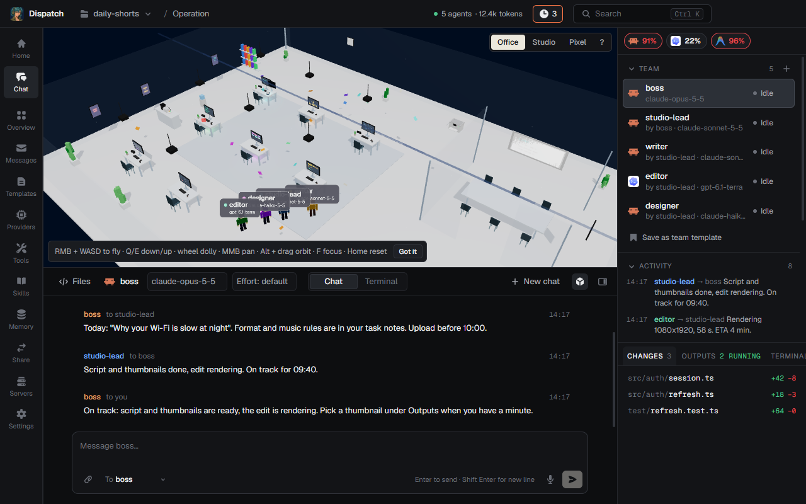
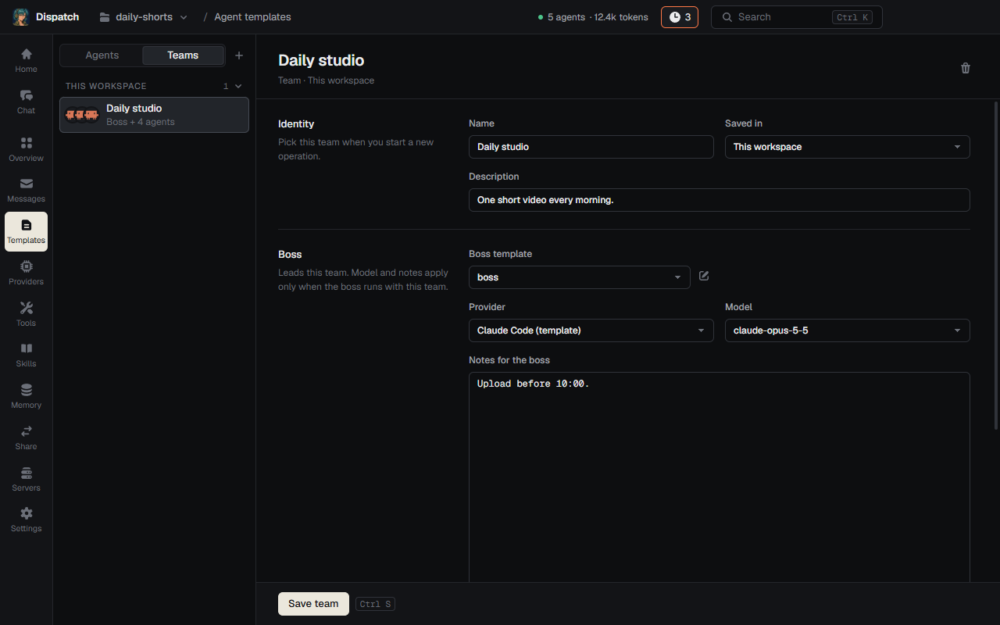
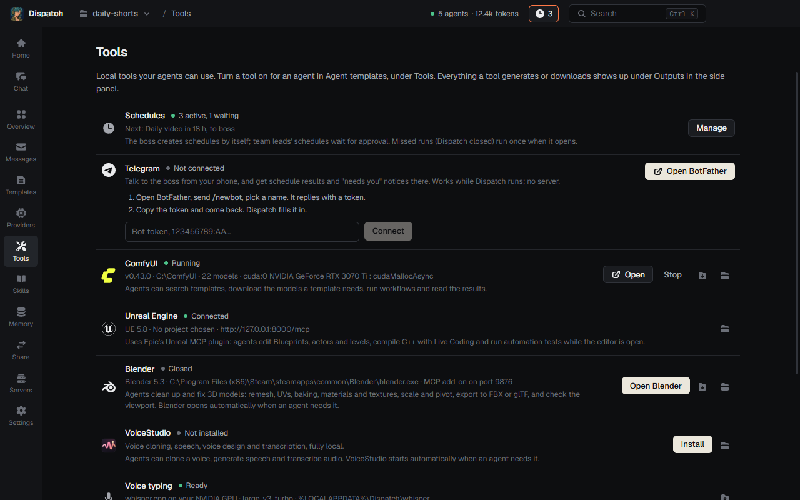
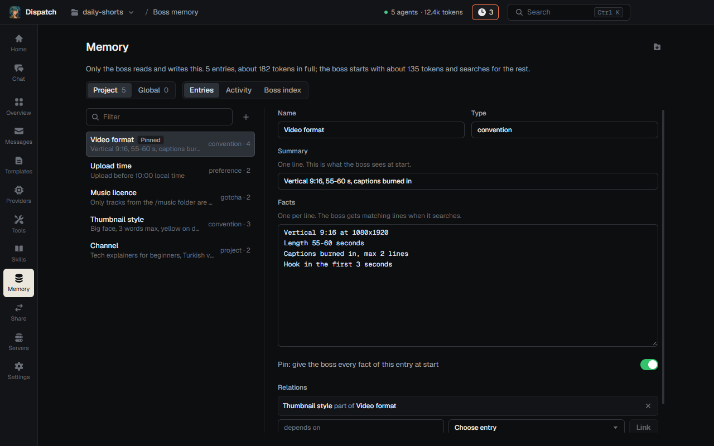
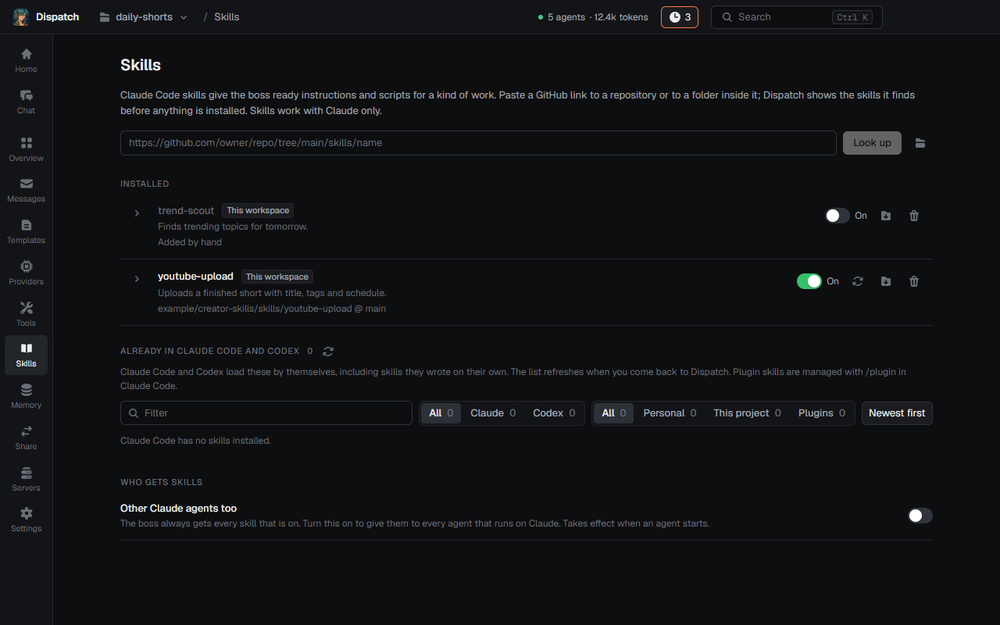

<p align="center"></p>

<h1 align="center">Dispatch</h1>

<p align="center">Run a team of coding agents from one window. A boss agent plans the work, enlists specialists on Claude Code, Codex, Antigravity, Gemini, OpenCode or a local model, and reports back to you.</p>



## What it does

- **A boss and its team.** You talk to the boss. It spawns agents from templates or one-off prompts, sends them work, and passes their results back. Team leads can enlist their own members.
- **Any CLI agent.** Each agent is the real provider CLI in its own terminal, signed in with your own account. Mix providers and models in one team, and switch a model mid-conversation.
- **Agent templates and teams.** Save agents as Markdown templates (per project or global) and whole teams as reusable setups.
- **Boss memory.** Long-term project and global memory for the boss, based on the MCP Memory server, with an editor to see and fix what it remembers.
- **Schedules.** The boss can schedule recurring or timed work ("every morning at 9, make the daily video"). Runs missed while Dispatch was closed run once when it opens.
- **Telegram.** Connect your own bot in a minute and talk to the boss from your phone. Schedule results and "needs you" notices arrive there too.
- **Tools for agents.** One-click setup for ComfyUI (image, video, audio, 3D), Blender, Unreal Engine, VoiceStudio, web search and more, exposed to agents over MCP. Everything they generate shows up under Outputs. Add your own tool in Tools: a command Dispatch keeps running in a terminal of its own (answer anything it asks there, such as a sign-in) and a note that tells every agent what it is and how to use it.
- **Questions in the chat.** When a Claude agent asks you something with options, the question and its choices show up in the chat; click an answer or type one, no terminal needed.
- **Skills.** Install Claude Code skills from a GitHub link and choose who gets them.
- **Built in:** a file editor with diffs, terminals, local voice typing (whisper.cpp), sharing agents and teams as `.dispatch` packs, and running a Dispatch on another computer over your network.

| | |
|---|---|
|  |  |
|  |  |

## Install

Installers will be published under [Releases](https://github.com/fatihacan1/dispatch-app/releases), and Dispatch will update itself from there. Until the first release, build it from source (below).

You also need at least one agent CLI, for example [Claude Code](https://docs.anthropic.com/en/docs/claude-code) or [Codex](https://github.com/openai/codex). The Providers page shows what is installed and can install, update and sign in to them for you.

Windows is the main platform today. macOS and Linux builds are not tested yet; help is welcome.

## Build from source

Needs Node.js 22+ and Go 1.27+.

```
git clone https://github.com/fatihacan1/dispatch-app
cd dispatch-app/desktop
npm install
npm run build:core
npm run dev
```

`npm run dev -- --demo` runs with fake agents, so you can try everything without any provider. More in [desktop/README.md](desktop/README.md).

## How agents talk

Every agent gets the `dispatch` CLI on its PATH. Messages are plain JSON files in `<workspace>/.dispatch`, so any CLI that can run a command can join:

```
dispatch send --to writer "Draft the script for tomorrow"
dispatch spawn --template coder --name c1 --task "Fix the failing test"
dispatch schedule add --title "Daily video" --why "One short every morning" --task "Make today's video" --every 1d --at 09:00
dispatch telegram send --text "Today's video is uploaded" --file out/thumb.png
```

Your chats, operations, templates and memory stay on your computer, in `~/.dispatch` and in each workspace's `.dispatch` folder.

## Contributing

Dispatch is fully open source and was built to make developers' work easier. It is far from finished and needs the community: bug reports, provider support, macOS and Linux testing, new tools, translations and design help are all welcome.

- Found a bug or have an idea? [Open an issue](https://github.com/fatihacan1/dispatch-app/issues).
- Want to fix something? Fork, make a branch, and open a pull request. Small focused PRs are easiest to review.
- Run `npm run typecheck` and `npm test` in `desktop/` before sending a PR.

If Dispatch helps you, a star on GitHub helps others find it.

## License

[MIT](LICENSE). Third-party assets and code are listed in [desktop/THIRD_PARTY_LICENSES.md](desktop/THIRD_PARTY_LICENSES.md).
